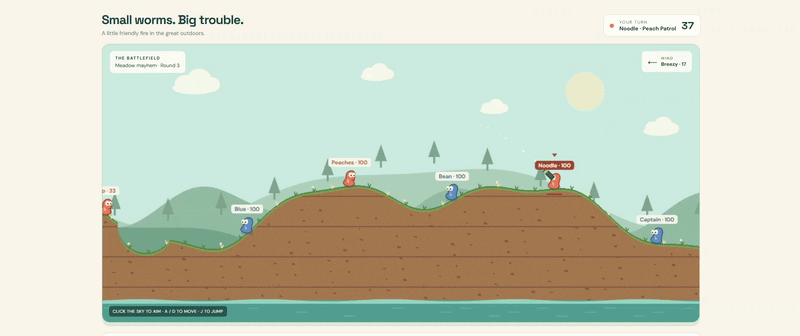

# Little Trouble — LAN artillery club

A colorful Worms-style prototype with 2–4 teams, three worms per team, bazookas, bouncing grenades, wind, destructible terrain, local players, and bots.

## What to extract

Extract the entire ZIP. It contains a `worms` folder. Keep the game HTML and server together in that folder. Do not run the server from inside the ZIP.

## Requirements

- **Host only:** Node.js 18 or later. A maintained Node.js LTS release is recommended. If it is not installed, obtain it from the official Node.js website, subject to your organization's software policy.
- **Everyone:** A modern browser and the same reachable Wi-Fi/Ethernet network.
- No npm packages, account, cloud service, or internet connection is needed to play. Optional Google Fonts fall back to system fonts offline.

## Host a match

1. On the host computer, start the server:
   - **Windows:** double-click `start-lan.bat`.
   - **macOS:** open Terminal in the extracted `worms` folder and run `sh start-lan.command`.
   - **Linux:** open a terminal in that folder and run `sh start-lan.sh`.
   - **Any platform:** alternatively, run `node server.cjs` from that folder.
2. Keep the terminal open. Open **http://localhost:8080** on the host, or the host address printed if you chose another port.
3. Choose **Play with friends on LAN** or **LAN play** and enter a nickname.
4. Choose **Create room**. A six-character room code appears.
5. Share one of the **Friends:** addresses printed by the server terminal and the room code. Use the address of the adapter connected to the network your friends use; VPN or virtual adapters may show additional addresses.
6. In the lobby, choose 2–4 teams and set each controller:
   - **Host device:** played on the host browser. Several teams can share that computer.
   - **Another LAN player:** one joined browser controls that team.
   - **Computer bot:** automatic opponent.
7. Wait for a player to occupy every remote team, then select **Start LAN match**.

The default configuration is one host team and one remote-player team. Add bot teams if desired. The host can pause/resume in the lobby and configure another match after the current one ends.

## Join from another computer or phone

1. Open the **Friends:** address supplied by the host in your browser. Do not use `localhost`: on your device, it refers to your own computer.
2. Choose **Play with friends on LAN**, enter a nickname and the room code, and select **Join room**.
3. Your team appears in the connection bar and lobby. The first available remote seat is assigned automatically. If every seat is occupied, you join as a spectator.
4. Close the lobby to watch the battlefield. Controls are enabled only on your team's turn.

Only the host needs Node.js or the extracted files. Other players need just a browser.

## Controls and rules

- **A / D** or the Move buttons: move, using your turn's movement allowance.
- **J** or Jump: jump.
- Click/tap the sky, use the angle slider, or press left/right arrows to aim. 90° is straight up; above 90° faces left.
- Power slider or up/down arrows: shot power.
- **1 / 2:** bazooka / grenade.
- **Space** or Fire away: fire once and end your turn.
- Skip turn: pass without shooting.
- Keyboard shortcuts work when the battlefield/page is focused, not while a slider or button has focus. Click the battlefield to restore game keyboard focus.
- Grenades have a three-second fuse. Friendly fire counts. Large falls cause damage and water is fatal.
- The last surviving team wins; if every team is eliminated, it is a draw.

## Disconnects and session limits

- Keep the game tab open. Player sessions are stored only in memory. Refreshing or closing the tab loses that browser's session token.
- Brief network interruptions reconnect automatically in the same tab.
- A disconnected human player's match pauses after roughly five seconds. After 30 seconds, their remote seat can be taken by an online spectator or a newly joined player. If you refreshed a remote-player tab, join again and wait for your old seat to reopen.
- If the host refreshes or closes its game tab, the original host session is lost. Create a new room rather than expecting host recovery. There is no host migration.
- Leaving as host closes the room. A stopped/restarted server loses all rooms and matches.
- The server supports up to eight rooms and sixteen browser sessions per room; each match has up to four teams. Unused rooms expire after 30 minutes.

## If another player cannot connect

- Check that you are on the same reachable network and that the server terminal is still running.
- Copy the correct **Friends:** address from the terminal. It may change when the host reconnects to the network.
- Guest Wi-Fi and corporate networks may isolate devices. Use a network that allows peer-to-peer traffic, with your organization's permission.
- If your firewall asks, allow Node.js **on a trusted private network only**, or ask IT to permit inbound TCP on the chosen port. Do not disable your firewall.
- VPN routing can interfere. Use an approved configuration that allows local-network access.
- If port 8080 is busy, run `node server.cjs 8081` and use the newly printed addresses. The command-line port overrides the `PORT` environment variable.
- You can check your Node.js version with `node --version`.

## Important security and preview limits

This is a prototype for a **trusted private LAN**, using plain HTTP. It does not provide public-internet hosting, encrypted transport, durable sessions, or production-grade anti-abuse protections. Do not forward its port through your router or expose it publicly. Room codes identify rooms; they are not strong access passwords. Browser session tokens are private and should not be shared.

The chat preview runs only same-computer play and bots. It deliberately makes no LAN requests. LAN becomes available when the included server serves the game in a normal browser. Downloading the HTML alone does not start a LAN server.

## Implementation and verification

The dependency-free Node.js server runs the physics engine contained in the HTML, validates team ownership and turn IDs, and sends authoritative game snapshots. Clients do not decide damage or terrain changes. Terrain is run-length encoded and sent only when its revision changes; large responses are gzip-compressed when supported.

Verified with local multi-client HTTP integration tests: room creation/join, host permissions, team ownership, movement, pausing, turn passing, networked grenades, crater/damage synchronization, duplicate-shot rejection, bots, four-team setup, spectators, seat reassignment, and missing-player pauses. JavaScript syntax and DOM element references were checked. Physical multi-device LAN connectivity and visual rendering in a real browser were not tested in this environment.
